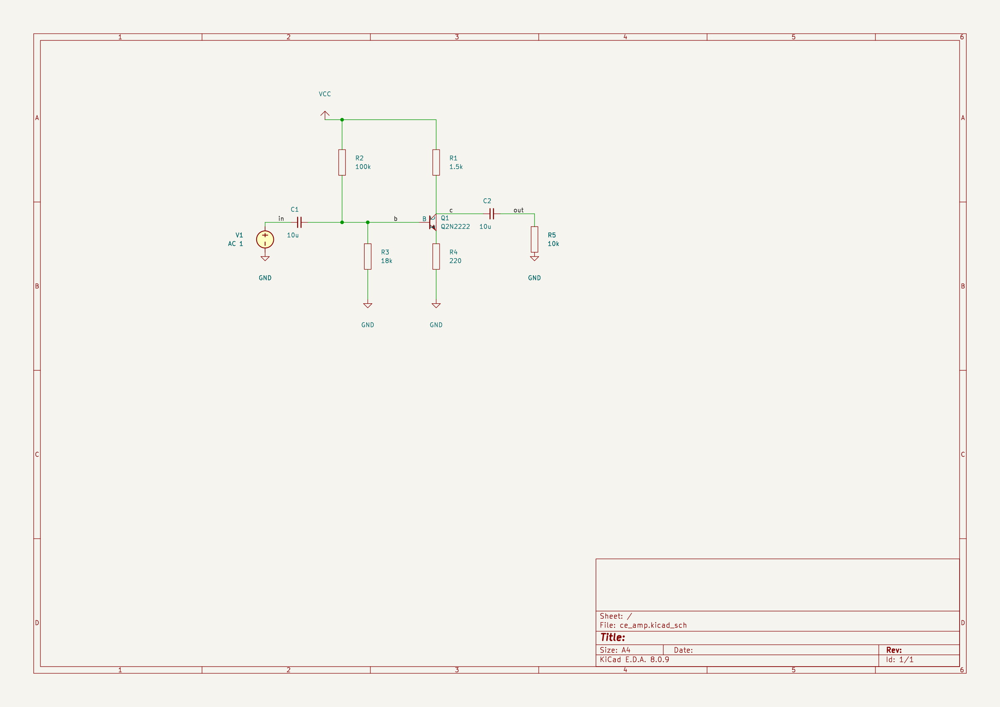
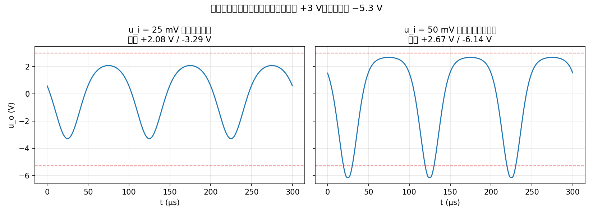

# SPICEBridge → KiCad 电路工作流

一条可重复的链路：**SPICE 网表 → 真实仿真 → KiCad 原理图 → 真实 KiCad 校验**。
仿真走本机 SPICEBridge MCP 服务，校验走真实 KiCad 8（`kicad-cli`），不靠"看起来对"。



> 上图就是 `run.py` 生成的 `.kicad_sch` 渲染结果，可直接在 KiCad 8 里打开编辑。

## 目录

```
spice-projects/
├── run.py                 # 一键：仿真 → 瞬态 → 出图 → 校验 → 渲染，结尾 RESULT 行
├── flow.py                # 多步 MCP 调用（同一 stdio 会话，circuit_id 才有效）
├── tran.py                # 直连 ngspice 批处理：稳态瞬态、THD、削顶墙、最大不失真
├── svg_anim.py            # 仿真结果 → 自包含 SVG 动画（纯 SMIL，无 JS）
├── mcp_call.py            # 单次 MCP 调用 / 列工具 / 查 schema
├── kicad_build.py         # 自带 KiCad 8 原理图生成器（器件库 + 布线 + 引脚坐标 dump）
├── verify_kicad.py        # 权威校验：kicad-cli 网表连通分割比对 + ERC 引脚检查
├── patches/               # SPICEBridge 1.3.0 修复补丁 + install.sh（重装后一键复现）
├── circuits/<name>/       # 一个电路一个目录
│   ├── netlist.cir        #   SPICE 网表（不含分析语句）
│   ├── layout.py          #   原理图版式脚本（`--pins` 可 dump 引脚坐标）
│   └── spec.json          #   要跑哪些分析（op/ac/tran/clipping_wall/max_undistorted/anim）
├── out/<name>/            # 产物：.kicad_sch / .svg / .png / _anim.svg（已 gitignore）
├── docs/                  # 示例渲染图 + 生成脚本
└── smoke/                 # 回归用例（rc 低通、bjt 共射）
```

## 快速开始

```bash
git clone https://github.com/kitsuneMori96/spicebridge-kicad-workflow.git
cd spicebridge-kicad-workflow
./patches/install.sh          # 给装好的 spicebridge 打上必需补丁（幂等）
python3 run.py circuits/ce_amp
```

依赖（Ubuntu/WSL）：

```bash
pip3 install --user spicebridge mcp cairosvg pillow   # SPICEBridge 自带 ngspice 调用
sudo apt install ngspice
sudo add-apt-repository ppa:kicad/kicad-8.0-releases && sudo apt install kicad
```

如果要在 agent CLI 里直接调用 SPICEBridge 工具（而非只用本仓库脚本），注册为 MCP 服务：

```bash
qodercli mcp add spicebridge ~/.local/bin/spicebridge --scope user --transport stdio
```

（会话内再执行 `/mcp reload` 生效。`run.py`/`flow.py` 不依赖这一步，它们自己起 stdio 会话。）

输出：

```
== q17: simulation ==
  op : {'v(vcc)': 12.0, 'v(b)': 0.7919, 'v(c)': 6.0488, ...}
  ac : gain 36.95 dB (dc), peak 41.22 dB
== q17: transient ==
  wall: +2.532 / -8.037 V, max undistorted Uo = 2.532 V peak (1.790 V rms)
== q17: schematic ==
== q17: KiCad verification ==
PASS: KiCad loads the file, pins are connected, netlist matches
== q17: SVG animation ==
  anim: out/q17/q17_anim.svg (110 KiB)
== q17: render ==
  out/q17/q17.png (2400x1697)

RESULT: PASS -> out/q17/q17.kicad_sch
```

`out/<name>/<name>.kicad_sch` 可直接用 KiCad 8 打开、修改、重新仿真。

## 加一个新电路

1. **写网表** `circuits/<name>/netlist.cir`
   ```spice
   * 分压偏置共射放大器
   VCC vcc 0 12
   V1 in 0 AC 1
   ...
   .model Q2N2222 NPN(BF=200)
   .end
   ```

2. **写版式** `circuits/<name>/layout.py`（照抄 `circuits/ce_amp/layout.py` 改坐标/器件）

   ```python
   import sys
   from pathlib import Path
   sys.path.insert(0, str(Path(__file__).resolve().parents[2]))  # 仓库根目录
   from kicad_build import Schematic, layout_main

   sch = Schematic("我的电路")
   Q1 = sch.add("Q1", "Q", "Q2N2222", ["c", "b", "e"], 127.00, 66.04, 0)
   R1 = sch.add("R1", "R", "1.5k", ["vcc", "c"], 129.54, 48.26, 0)
   sch.wire((129.54, 35.56), R1.pin("1"))
   sch.connect(R1.pin("2"), Q1.pin("C"))   # 自动拐一次弯
   sch.power_port("power:VCC", 96.52, 35.56)
   sch.label("c", 133.35, 63.50)

   if __name__ == "__main__":
       raise SystemExit(layout_main(sch))
   ```

   - 坐标单位 mm，全部落在 1.27 mm 栅格上（`snap()` 会强制对齐）
   - `part.pin("1")` 按引脚号取坐标，`part.pin_for("b")` 按网表节点名取坐标
   - 器件位号必须是「字母 + 数字」（`R4`、`R5`），`RE`/`RL` 这种会被 KiCad 判为未标注
   - 连线老是不连通（NETLIST MISMATCH）时先跑 `python3 layout.py --pins`，
     拿到每个引脚的绝对坐标再对——`run.py` 校验失败时也会自动 dump 这张表

3. **写分析** `circuits/<name>/spec.json`
   ```json
   {
     "op": true,
     "ac": { "start": 10, "stop": 10000000, "ppd": 20 },
     "tran": { "source": "V1", "node": "out", "freq": 1000, "amp": 0.03 },
     "clipping_wall": { "source": "V1", "node": "out", "freq": 1000 },
     "max_undistorted": { "source": "V1", "node": "out", "freq": 1000, "thd": 1.0 }
   }
   ```

   - `tran`：指定输入幅值跑瞬态，自动加倍时长直到稳态，报告输出峰值与 THD
   - `clipping_wall`：教材口径的「最大不失真输出」——幅值倍增直到输出峰值不再
     增长（硬削顶渐近线），取正/负墙较小者，`wall_rms_V = wall_peak / √2`
   - `max_undistorted`：工程口径——按 THD 限值几何加倍 + 二分找输入幅值
   - 瞬态直连本机 ngspice 批处理（`tran.py`），不走 MCP；也可单独用：
     `python3 tran.py circuits/q17/netlist.cir out`

4. `python3 run.py circuits/<name>`，结尾必须看到 `RESULT: PASS`。

## 校验到底校验了什么

`verify_kicad.py` 做两件事，都调用真实 KiCad：

1. **网表连通性**：`kicad-cli sch export netlist --format spice` 让 KiCad 自己算网表，
   再把「哪些引脚同网」与源网表逐组比对。只比较两边都能导出的端子，所以没有 SPICE
   模型的 Q/X 器件不会造成假报错；但**短路、断路、错连一定会被抓到**。
2. **ERC**：`kicad-cli sch erc` 不允许出现 `pin_not_connected`，覆盖第 1 步看不到的
   晶体管 / 子电路引脚。

两条都过才返回 0。CI 里可以直接用退出码。

## 已知限制

- **Q / X 器件不出现在 KiCad 导出的 SPICE 网表里**：KiCad 只导出能映射到 SPICE 原语的
  器件，没有模型的符号会写成 `Q1 __Q1`。它们的连通性由 ERC 保证，而不是网表比对。
- **版式是手写的**：自动布局（`auto_layout`）只适合简单链式电路，复杂电路请写显式坐标。
  这样出来的图才像人画的。
- **KiCad 视图里的 "library not configured" 警告**是正常的：符号已内嵌在文件里，不依赖
  本机库表。
- `spicebridge` 的 site-packages 补丁已固化在 `patches/`，重装后跑一次
  `./patches/install.sh` 即可（幂等，`--check` 只查状态）。

## 对 SPICEBridge 的本地补丁（patches/）

| 补丁 | 问题 | 处理 |
|---|---|---|
| `spicebridge-1.3.0-simulator.patch` | spicelib 共享库后端把 ngspice banner 写到进程 stdout，冲垮 MCP stdio 协议 | 默认走子进程后端（输出被捕获），`SPICEBRIDGE_USE_SPICELIB=1` 可切回 |
| `spicebridge-1.3.0-kicad_export.patch` | 导出的 `.kicad_sch` KiCad 8 打不开；BJT/二极管的 SPICE 节点序与 KiCad 引脚号不一致导致错连；子电路符号名带库前缀 | 修正符号名、栅格、引脚映射，并为 X 子电路生成带编号的框符号 |

补丁对干净 wheel 逐级可复现（先 `pip3 download spicebridge==1.3.0 --no-deps`
解包，再对 `whl/` 目录 `patch -N -p1`），所以它们同时是升级时的行为回归基线。

> 原理图主力生成器仍是本仓库的 `kicad_build.py`（每张图都过 KiCad 8 实测校验），
> `kicad_export.py` 的补丁只用于让原工具在别的场合不至于崩。banner 污染 stdout
> 的问题已向上游提 PR（clanker-lover/spicebridge）。

## 仿真结果动画（SVG）

spec 里带 `anim` 段时，`run.py` 会额外产出 `out/<name>/<name>_anim.svg`：
自包含、纯 SMIL，没有 JS 和外部依赖，浏览器打开就播，GitHub README 里也直接播。



画面里的每一根线都来自真实 ngspice 瞬态：

- **黄色主波形**：`u_o(t)`，描边随播放头逐点画出；红虚线是教材口径的两道墙
  （电流截止 +3 V、饱和 −5.3 V）
- **青色小条**：`u_i(t)`，用来对照输入幅度
- **右侧平面**：`Δi_C – Δu_CE` 增量轨迹，实测斜率就是 `−1/(Rc∥RL) = −1/1.5 kΩ`；
  亮点沿轨迹走，能直接看到工作点被推到截止边
- **右上角读数**：跟随播放头的瞬时数值，全部来自仿真数组

配置示例（`circuits/q17/spec.json`）：

```json
"anim": {
  "source": "V1", "amp": 0.05, "freq": 1000, "window_cycles": 3,
  "traces": [
    { "expr": "v(out)", "label": "u_o", "unit": "V",  "scale": 1,    "digits": 2 },
    { "expr": "v(in)",  "label": "u_i", "unit": "mV", "scale": 1000, "panel": "input" }
  ],
  "limits": [ { "value": 3.0, "label": "电流截止墙 +3 V" } ],
  "plane": {
    "x_expr": "v(c) - v(e)", "y_expr": "-i(VIC) * 1000",
    "probe": { "q": "Q1", "source": "VIC" }
  }
}
```

- `traces[].expr` 是 ngspice 向量表达式；`panel: "input"` 的画在下方小条
- `plane.probe` 会在 Q 的集电极**临时**串一支 0 V 电流表：不改变工作点，也不进原理图。
  必须这么做，是因为 `@q1[ic]` 只在工作点求值，瞬态里是常数，画不出轨迹
- 波形走 `tran.waveform()`：自动等到稳态，再取末尾 `window_cycles` 个周期
- 单独生成：`python3 svg_anim.py circuits/q17`，加 `--png` 顺带出静态预览图

**为什么不用 JS**：GitHub README 用 `` 引用 SVG，脚本会被沙箱挡掉；SMIL 不会。
不支持 SMIL 的渲染器（cairosvg、打印、部分预览器）看到的是静态全波形：
描边动画的初始值就是「已画完」，所以不会白图。

## 讲解动画（scene）

`q17_anim.svg` 只重播仿真波形；`scene` 把同一道题拆成六幕，放在一条 21.2 s 的
全局时间轴上：

| # | 场景 | 讲什么 |
|---|---|---|
| 1 | 题目条件 | Vcc / Rc / RL、Q 点、输入 50 mV / 1 kHz；原理图逐器件高亮、输出回路流动 |
| 2 | 静态工作点 | C2 直流开路 → DC 负载线 (0, 4 mA)→(12 V, 0)，Q 点向两轴投影 |
| 3 | 交流负载线 | Vcc 交流接地、C2 短路 → Rac = Rc∥RL = 1.5 kΩ，斜率三角形量出 −0.667 mA/V |
| 4 | 三种口径 | 教材、50 mV 波形、倍增幅值扫描并排；结论行高亮 |
| 5 | 波形族 | 20 / 50 / 100 / 200 mV 输出同屏：正峰先长后压，负峰持续变深 |
| 6 | 结论 | Uo ≈ 1.79–1.94 Vrms ≈ 2 V，选 A（2 V） |



实现约束：

- 纯 SMIL、单文件、无 JS / 外部资源，GitHub README 的 `` 直接播放；
- 全局时间轴：所有 `animate` 的 `dur` 都等于 total_duration，统一 `keyTimes`，
  不用 `begin` / `end`，六幕不会漂移；
- 不支持 SMIL 的渲染器（cairosvg、打印）看到静态海报：标题、答案、波形、三口径表
  都在，不会白图；动画层在海报消失后才开始；
- 场景由 `circuits/q17/scene.json` 声明，文字里的 `{{path:format}}` 在渲染时从
  ngspice 结果注入，不手写关键数值；未知路径直接报错。

`scene.json` 最小示例：

```json
{
  "version": 1,
  "data": { "amp": 0.05, "freq": 1000, "probe": { "q": "Q1", "source": "VIC" } },
  "scenes": [
    {
      "id": "given", "layout": "card", "duration": 3.0,
      "title": "题目给了什么？",
      "elements": [
        { "type": "bullets", "pos": [42, 130],
          "items": [{ "text": "V_{CC}=12 V，R_{c}=R_{L}=3 kΩ", "at": 0.2 }] }
      ]
    }
  ]
}
```

命令：

```bash
python3 scene_anim.py circuits/q17 --check           # 只校验数据 / 模板 / 引用
python3 scene_anim.py circuits/q17 --still all --png # 六张静态审阅图
python3 scene_anim.py circuits/q17 --png             # 完整动画 + 海报 PNG
```

`run.py circuits/q17` 在 `spec.json` 带 `"scene": {"file": "scene.json"}` 时也会
自动生成 `out/q17/q17_scene.svg`（放在原理图导出之后，嵌入真实 KiCad SVG）。

三种口径为什么都指向 2 V：

- 教材按 +3.0 / −5.3 V 的理想墙估算，取较小的正峰 → 3.0/√2 = 2.12 Vrms；
- 50 mV 实际波形正峰 +2.74 V、负峰 −6.02 V → 1.94 Vrms；
- 倍增幅值扫描在更大输入下正峰被耦合电容的整流效应压低到 +2.53 V、
  负峰到 −8.04 V → 1.79 Vrms。

扫描值不是一条绝对水平墙：它和 +2.74 V 一起说明「正峰大约 2.5–2.7 V」。
真正先限制输出的是截止侧的正峰，所以答案仍是 A（2 V）。

## 教材例题索引

模电「共射放大器」系列选择题的完整闭环案例：网表 → MCP 仿真 → 瞬态扫描 →
KiCad 原理图 → 校验 PASS。

| 题 | 考点 | 电路 | 仿真实测 | 答案 |
|---|---|---|---|---|
| 17 | 最大不失真输出电压 Uo | `circuits/q17` | U_CEQ=6.05 V；削顶墙 +2.53/−8.04 V → Uo=1.79–1.94 Vrms（扫描 1.79 / 50 mV 波形 1.94） | **A（2 V）**，截止侧先碰墙 |
| 18 | 分压偏置求 U_CEQ | `circuits/q18` | v(b)=2.64 V, v(e)=1.85 V, v(c)=6.50 V → U_CEQ=4.64 V | **B（4.5 V）** |
| 19 | 画交流等效电路 | 概念题，对照 q18/q20 两份网表 | Ce 是否存在决定 Re 进不进交流通路 | **B** |
| 20 | 求电压增益 A_u | `circuits/q20`（= q18 去掉 Ce） | \|Au\|=3.21 dB=1.45 倍（含 Re 负反馈） | **A（−1.5）** |

静态对比（25 mV 未削顶 vs 50 mV 正半周削顶，`docs/make_q17_waveform.py` 生成）：



两个值得留意的物理细节：

- **THD 判据与教材口径不等价**。BJT 指数特性使软削顶在微伏级输入就存在，THD
  1% 判据（`max_undistorted`）给出的「最大不失真」远小于教材的硬削顶墙
  （`clipping_wall`）。做题用后者，做功放线性度指标用前者。
- **输出耦合电容需要建立时间**。`run_tran` 会自动把时长加倍直到最后两周期峰值
  差 <2%（τ=R_L'·C₂=30 ms 时约需 120 ms 仿真时长），不然测到的输出接近 0。

## 环境

- ngspice 36 `/usr/bin/ngspice`
- KiCad 8.0.9 `/usr/bin/kicad-cli`（PPA `kicad-8.0-releases`）
- SPICEBridge 1.3.0 `/home/kitsunemori/.local/bin/spicebridge`
- 渲染：`kicad-cli sch export svg` + cairosvg
